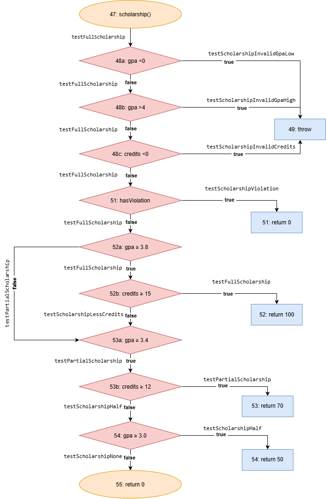

# Лаборатори №9 - Код хамралт

**Оюутны нэр:** С.Туяацэцэг
**Оюутны код:** B210910804

## Ашигласан орчин

**Java:**

```text
$ java -version
openjdk version "25.0.5.0.2" 2026-10-22 LTS
OpenJDK Runtime Environment Microsoft-15804669 (build 25.0.5.0.2+1-LTS)
OpenJDK 64-Bit Server VM Microsoft-15804669 (build 25.0.5.0.2+1-LTS, mixed mode, sharing)
```

**Maven:**

```text
$ mvn -version
Apache Maven 3.10.0 (c43a36b8d67be7e0805a411bc0898af1a51f5472)
Maven home: /usr/local/sdkman/candidates/maven/current
Java version: 25.0.5.0.2, vendor: Microsoft, runtime: /usr/local/sdkman/candidates/java/25.0.5.0+2-ms
Default locale: en, platform encoding: UTF-8, time zone: Etc/UTC
OS name: "linux", version: "6.8.0-1070-azure", arch: "amd64", family: "unix"
```

## A. Happy path тест

letterGrade(), gpa(), scholarship() функцүүдийн
хэвийн ажиллагааг шалгах 5 тест бичив.

| Тест | Оролт | Expected |
|---|---|---|
| testGradeA | 95 | A |
| testGradeB | 85 | B |
| testGpa | [95,85] | 3.5 |
| testFullScholarship | 3.9,16,false | 100 |
| testPartialScholarship | 3.5,12,false | 70 |

### A хэсгийн үр дүн

| Хэмжүүр | Missed | Covered | Нийт | Хамралт |
|---|---|---|---|---|
| Line | 10 | 15 | 25 | 60% |
| Branch | 21 | 20 | 41 | 48.8% |

5 тест бүгд амжилттай ажилласан.
Одоогоор зөвхөн хэвийн оролтуудыг шалгасан тул
алдаатай оролт болон нөхцөлийн зарим салаа
хамрагдаагүй байна.

Үр дүн:
- results/mvn-verify-A.txt
- results/jacoco-A.csv

JaCoCo тайлангийн 20, 31, 48-р мөрүүдэд
шар ромбо гарсан. Буруу оролтын exception
шалгах тестүүд дутуу байна.

letterGrade-ийн C, D, F дүн болон scholarship-ийн
50%, 0%-ийн нөхцөлүүд улаан харагдсан.
Дараагийн хэсэгт эдгээрийг шалгах тест нэмнэ.

## B. CFG ба код хамралт

scholarship() функцийн CFG-г зурж,
ирмэг бүрд тохирох тестийн нэрийг бичив.



A хэсгийн 5 тест дээр 15 тест нэмсэн.

| Хэмжүүр | A хэсэг | B хэсэг |
|---|---|---|
| Тестийн тоо | 5 | 20 |
| Line coverage | 60% | 100% |
| Branch coverage | 48.8% | 100% |

Буруу оролт, C, D, F дүн болон тэтгэлгийн
үлдсэн нөхцөлүүдийг шалгах тест нэмсэн.
Мөн && болон || нөхцөлүүдийг тус тусад нь шалгав.

Нийт 20 тест амжилттай ажилласан.

BRANCH_MISSED = 0
LINE_MISSED = 0

Үр дүн:
- results/mvn-verify-B.txt
- results/jacoco-B.csv

## C. Давталтын заагийн тест

| Давталт | Оролт | Expected | Тест |
|---|---|---|---|
| 0 | [] | Exception | testGpaEmpty |
| 0 | null | Exception | testGpaNull |
| 1 | [95] | 4.0 | testGpaSingleScore |
| 2+ | [95,85,75,65] | 2.5 | testGpaMultipleScores |

Хоосон болон null массивын тестийг B хэсэгт
бичсэн тул нэг болон олон дүнтэй тест нэмж шалгав.

Хамралт аль хэдийн 100% болсон ч давталтын
өөр өөр тохиолдолд зөв ажиллахыг шалгах хэрэгтэй.
Эдгээр тест нь голч дүн зөв бодогдож байгаа
эсэхийг баталгаажуулна.